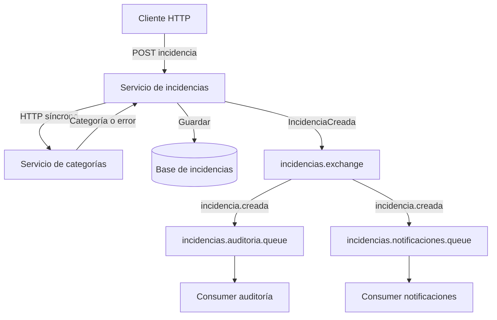

# EV2 Comunicación síncrona y asíncrona con RabbitMQ

Implementación académica del caso Mini Help Desk de CloudWork. Cuatro procesos Spring Boot independientes, RabbitMQ y bases H2 separadas. Los procesos comparten un artefacto Java y seleccionan su responsabilidad con perfiles. El backend y Angular de EV1 se conservan; este módulo se prueba mediante HTTP, sin Azure, AWS ni cambios en el frontend.

**Estado de esta entrega:** código preparado y revisado estáticamente. No se ha ejecutado la compilación ni la integración: el entorno de preparación no dispone de Docker y no pudo descargar dependencias de Maven Central. La conexión a GitHub rechazó la escritura con HTTP 403. No hay capturas ni resultados de ejecución inventados. El workflow genera evidencias reales cuando se ejecuta.

## Arrancar en Windows

Requisito: Docker Desktop iniciado y configurado para contenedores Linux, con Docker Compose v2. La primera construcción necesita internet para descargar imágenes y dependencias.

1. Descomprime el ZIP y abre PowerShell dentro de `CloudWork/ev2-rabbitmq`.
2. Ejecuta:

```powershell
docker compose up -d --build
docker compose ps
```

Espera a que los servicios arranquen. Comprueba `http://localhost:8081/health`; si aún no responde, revisa `docker compose logs incidencias`.

3. Crea una incidencia y consulta ambos resultados:

```powershell
powershell -ExecutionPolicy Bypass -File .\scripts\demo.ps1
```

El script de demostración es texto incluido en esta entrega. También puedes copiar sus comandos a PowerShell.

4. Abre RabbitMQ Management: http://localhost:15672. Usuario `ev2`, contraseña `ev2-local-demo`. Son credenciales de demostración local. Los puertos del compose se vinculan a 127.0.0.1.
5. En **Exchanges** abre `incidencias.exchange` y revisa sus dos bindings. En **Queues and Streams** revisa las dos colas y sus consumidores.

| Proceso | Puerto | Endpoint |
|---|---:|---|
| Incidencias | 8081 | POST y GET /api/incidencias |
| Categorías | 8082 | GET /categorias y /categorias/1 |
| Auditoría | 8083 | GET /procesados |
| Notificaciones internas | 8084 | GET /procesados |
| RabbitMQ Management | 15672 | Interfaz web |

## Demostrar el desacoplamiento

```powershell
docker compose stop auditoria notificaciones
$body = @{ titulo="Prueba con consumidores detenidos"; descripcion="EV2"; categoriaId=1; prioridad="ALTA" } | ConvertTo-Json
Invoke-RestMethod -Method Post -Uri http://localhost:8081/api/incidencias -ContentType "application/json" -Body $body
```

La respuesta esperada es 201 con `publicacion: CONFIRMADA`. En Management, cada cola debe mostrar un mensaje **Ready**, con cero consumidores. Captura esa pantalla antes de continuar.

```powershell
docker compose start auditoria notificaciones
```

Cuando inicien, consulta ambos `/procesados` y confirma el mismo `EVENTO_ID`. Las colas deben vaciarse. El procesamiento asíncrono puede completarse incluso antes de que se observe la respuesta del POST; la independencia se demuestra deteniendo los consumers.

## Demostrar la dependencia síncrona

Cambia `categoriaId` a 999 en la solicitud: se espera HTTP 400 y no se guarda una incidencia. Con `docker compose stop categorias`, una solicitud válida devuelve 503; el guardado tampoco se realiza. Reinicia con `docker compose start categorias`.

## Evidencias automáticas e informe actualizado

Con Python 3 disponible, desde esta carpeta:

```powershell
python -m pip install playwright python-docx
python -m playwright install chromium
python scripts/verify.py
docker compose logs --no-color | Out-File -Encoding utf8 evidence/servicios.log
python scripts/build_report.py
```

`verify.py` prueba HTTP real, broker real y consumers reales; detiene y reinicia servicios locales de este compose. Captura tres pantallas de RabbitMQ y escribe JSON con solicitudes, resultados y topología en `evidence/`. Si falla, conserva evidencias parciales y devuelve un error: no debe interpretarse como PASS. El informe actualizado queda en `evidence/Informe_EV2_RabbitMQ.docx` e incorpora las capturas disponibles y el estado real de la verificación. Tras una falla, `docker compose up -d` restaura los servicios.

Las pruebas unitarias se ejecutan con Java 17 y Maven: `mvn test`. También puedes usar el wrapper existente: en PowerShell `..\diagnostico-backend\mvnw.cmd -f pom.xml test`; en Linux `bash ../diagnostico-backend/mvnw -f pom.xml test`.

## Subir los cambios y usar GitHub Actions

En tu copia Git existente de CloudWork, copia la carpeta `ev2-rabbitmq` y el archivo `.github/workflows/ev2-rabbitmq.yml` incluidos en el ZIP. Desde la raíz de esa copia:

```powershell
git switch -c codex/ev2-rabbitmq
git add ev2-rabbitmq .github/workflows/ev2-rabbitmq.yml
git commit -m "Implementar actividad EV2 RabbitMQ"
git push -u origin codex/ev2-rabbitmq
```

El workflow se activa por ese push. En GitHub → Actions → **EV2 RabbitMQ verificación real**, espera el resultado y descarga `evidencias-ev2-rabbitmq`. Contiene resultados, capturas y el informe regenerado. Revisa visualmente el Word actualizado antes de entregarlo. Si Actions está deshabilitado, debe habilitarlo un propietario del repositorio. El cambio no se ha subido desde el entorno de preparación.

## Diseño



El exchange es `direct`, durable. Ambas colas son durables y sus bindings usan la misma routing key. Cada responsabilidad recibe su propia copia. Dos consumidores de una única cola competirían por los mensajes y no cumplirían este objetivo.

La validación de categorías determina si la operación puede continuar. La auditoría y la notificación interna se procesan después sin que el producer espere su respuesta. El producer sí espera hasta cinco segundos la confirmación del broker; ese ACK no significa que un consumer haya terminado.

## Separación del código

- `api/`: HTTP y validación de entrada.
- `application/`: coordinación del registro y procesamiento de auditoría/notificación.
- `domain/Contracts.java`: contratos y evento.
- `infrastructure/`: cliente HTTP, persistencia JDBC, topología y adaptadores AMQP.

## Alcance y límites

La notificación es un registro interno durable consultable por HTTP; no envía correo ni WhatsApp. El catálogo tiene tres categorías fijas para esta demostración. Cada proceso consumidor guarda su resultado en su propia base H2 de archivo. El merge por `eventoId` evita filas duplicadas, pero no ofrece idempotencia avanzada para efectos externos.

Si el broker falla tras guardar, la incidencia devuelve 201 con `publicacion: PENDIENTE` y se registra `PUBLISH_FAILED`; no se afirma que el evento haya sido entregado. No existe recuperación automática de pendientes. Hay una ventana de fallo entre persistencia y publicación; un outbox transaccional sería una mejora de producción. No hay DLQ ni retries avanzados. Un mensaje rechazado no se reencola automáticamente y puede perderse. Esta configuración es una demostración local, sin autenticación de aplicación.

`docker compose down` detiene y elimina los contenedores pero conserva los volúmenes. No uses `down -v` si quieres conservar incidencias y evidencias en las bases. Los JSON y PNG guardados en `evidence/` permanecen en tu carpeta.

## Referencias

- https://www.rabbitmq.com/tutorials/tutorial-four-spring-amqp
- https://www.rabbitmq.com/tutorials/tutorial-three-java
- Repositorio base: https://github.com/F1xha/CloudWork
